# Shaffof

**A verifiable ledger for charity funds, and a sourced zakat calculator.** *Shaffof* means "transparent" in Uzbek.

[](https://www.bestpractices.dev/projects/16670)
[](https://scorecard.dev/viewer/?uri=github.com/wonmortech/shaffof)
[](https://github.com/wonmortech/shaffof/actions/workflows/ci.yml)
[](https://developer.mozilla.org/en-US/observatory/analyze?host=shaffof.wonmor.io)
[](https://www.ssllabs.com/ssltest/analyze.html?d=shaffof.wonmor.io)

**[Website](https://shaffof.wonmor.io) · [Live demo](https://wonmor.io/demo/shaffof/) · [Docs](docs/PLAN.md) · [Releases](https://github.com/wonmortech/shaffof/releases)**

> **Status: planning. No product is released yet.** The live demo is a *concept demo*: the planned UI running
> in your browser on 16 fictional funds. The hashing and proofs in it are real (SHA-256, RFC 9162); the funds,
> amounts and receipts are not. There is no hosted service and no partner fund.

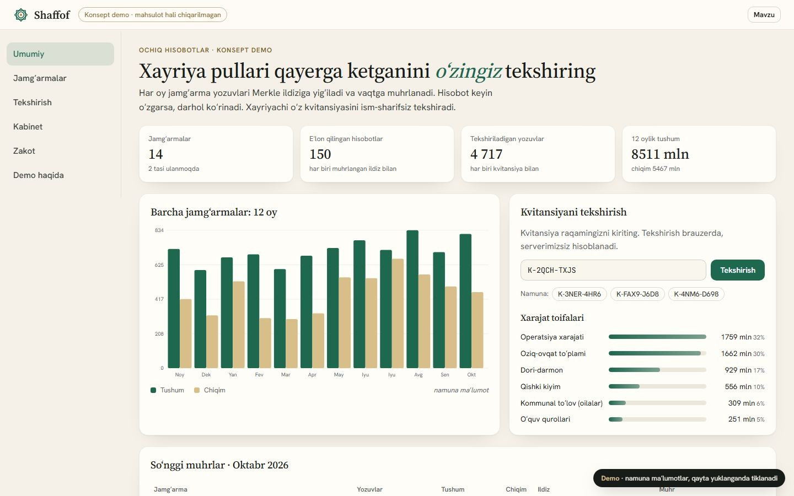

## What it does

- **Monthly sealed reports.** A fund's append-only ledger is folded into a Merkle tree each month; the root is
  timestamped with [OpenTimestamps](https://opentimestamps.org/) and published.
- **Tamper evidence.** Anyone can recompute a report and see at once if a single amount changed after publication.
- **Receipt proofs.** A donor checks with a receipt number, and no name, that their gift is in the report (an
  inclusion proof, as in [RFC 9162](https://www.rfc-editor.org/rfc/rfc9162)), computed in the browser.
- **Independent audit.** The proof is plain JSON (entry, sibling hashes, root) that an auditor verifies without our server.
- **Append-only console.** Funds add entries, fix mistakes with reverse entries (never edits or deletes) and seal the month.
- **Zakat calculator.** Four madhhab methods side by side, each with its source; it gives no rulings of its own
  and stores nothing.

## Screenshots

| | |
|---|---|
| 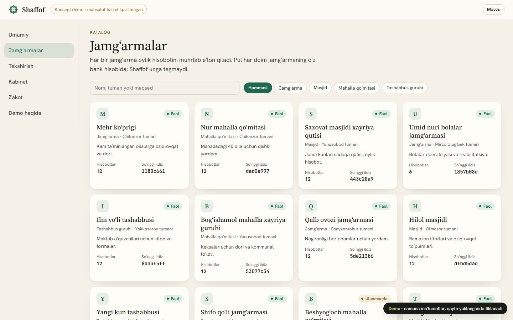 | 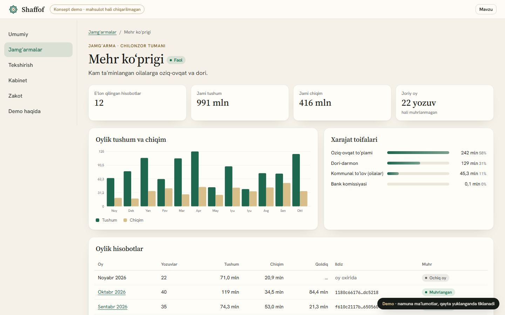 |
| 16 fictional funds, mosques and mahalla committees, each with its own sealed history. | One fund: monthly income and spending, categories and every sealed report. |
| 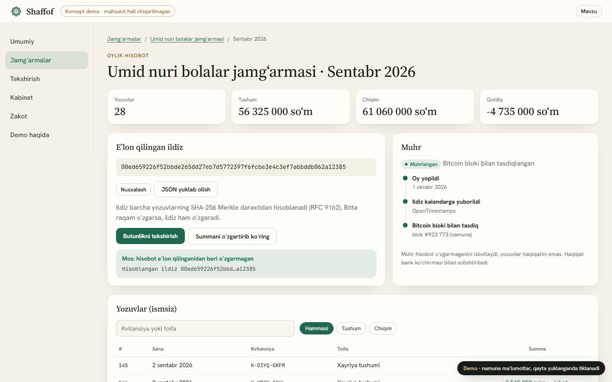 | 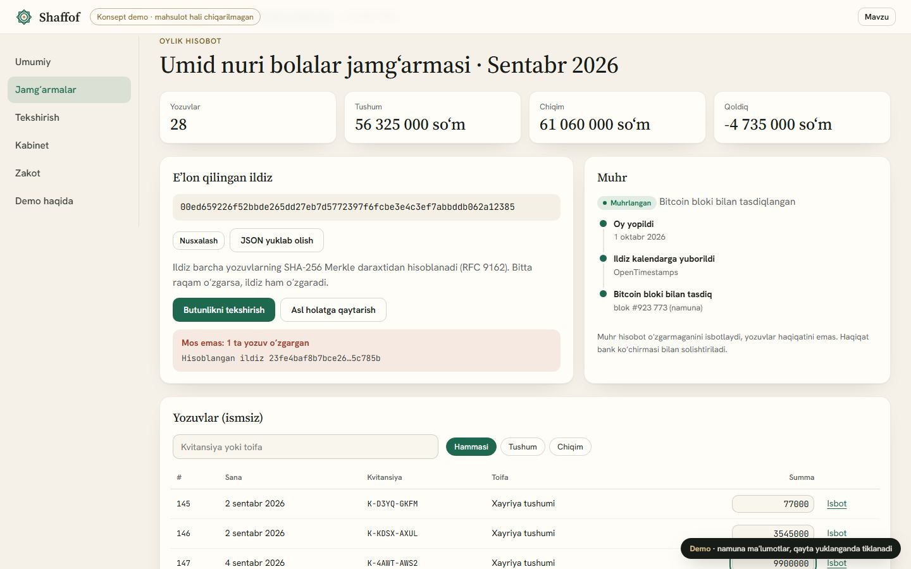 |
| A monthly report: published root, seal timeline, integrity check passes. | Change one amount and the recomputed root no longer matches. |
| 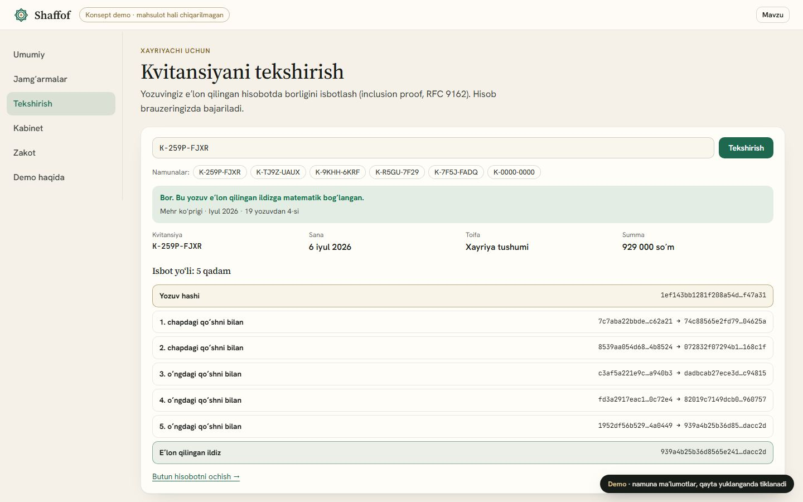 | 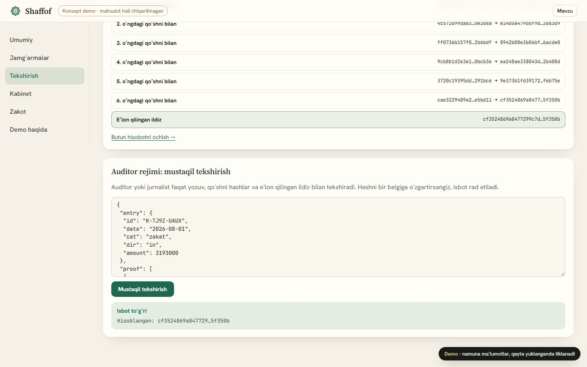 |
| A donor's receipt: the proof path from the entry hash up to the published root. | Auditor mode: the proof as JSON, verified independently; edit one byte and it fails. |
| 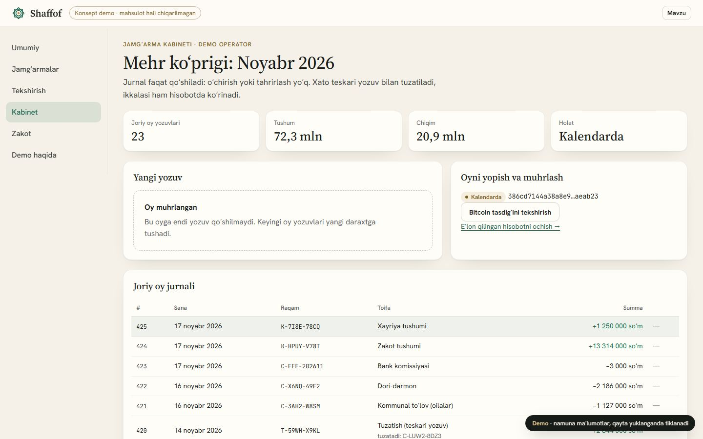 | 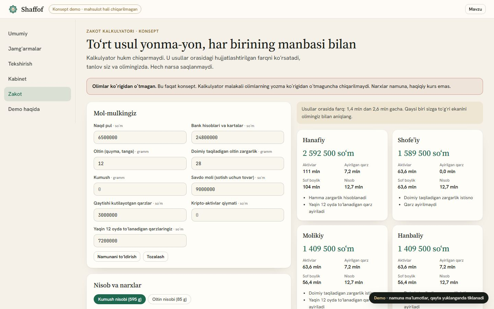 |
| Fund console (demo / demo): add entries, reverse a mistake, seal the month. | Concept zakat calculator: four methods, their differences and sources. |
| 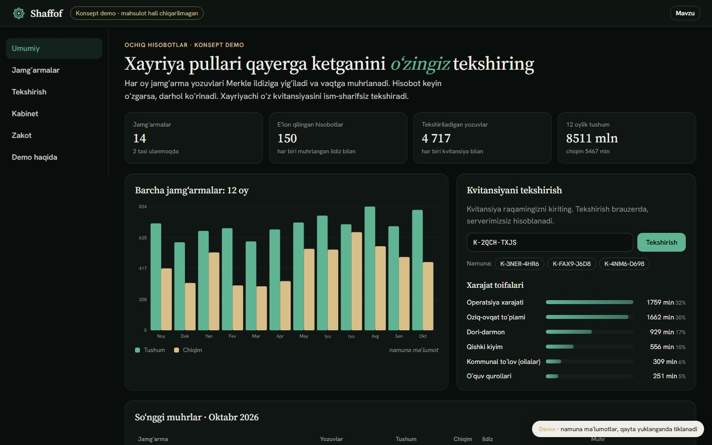 | 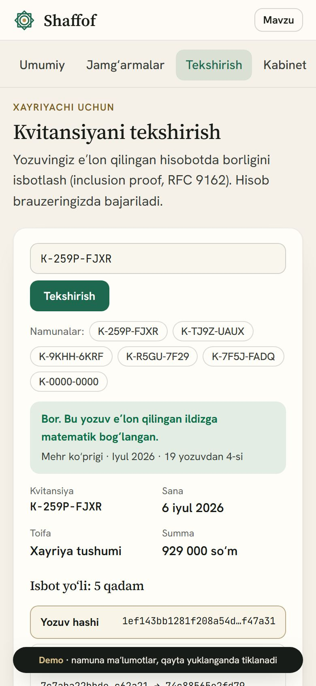 |
| Dark theme. | Receipt check on a phone. |

## Quick start

```sh
npm ci --ignore-scripts && npm run demo   # then open http://127.0.0.1:4174/demo/shaffof/
```

The home page needs no build at all: serve `site/` as it is (`npm run serve`).

## Verify a proof yourself

Copy a proof from the demo's auditor mode into `proof.json`, then check it with the same code the site uses:

```js
// node verify.cjs
const M = require('./site/assets/js/merkle.js');
const { entry, proof, root } = require('./proof.json');
M.verify(entry, proof.map((p) => ({ side: p.side, hash: Buffer.from(p.hash, 'hex') })), root)
  .then((r) => console.log(r.ok ? 'included' : 'NOT included'));
```

## What it is not

- It never collects, holds or moves money. Payments go through the fund's own bank account.
- No token, no crypto payments. Sealing only ties a hash to a point in time.
- No donor names in public reports, and no donor rankings or leaderboards.
- No fatwas. **Zakat rulings must be confirmed by qualified scholars:** the calculator will not be released until
  its methods and sources have been reviewed in writing. Nothing here is legal or religious advice.

## Docs

- [docs/PLAN.md](docs/PLAN.md): goals, architecture, milestones, risks, open questions (Uzbek)
- [docs/research/](docs/research/): competitors, references, legal and sharia notes (Uzbek)
- [DESIGN.md](DESIGN.md): visual direction · [docs/ASSURANCE.md](docs/ASSURANCE.md): security assurance case
- [SECURITY.md](SECURITY.md): reporting a vulnerability and [verifying a release](SECURITY.md#verifying-a-release)
- [GOVERNANCE.md](GOVERNANCE.md), [CONTRIBUTING.md](CONTRIBUTING.md), [CHANGELOG.md](CHANGELOG.md)

## Development

```sh
npm ci --ignore-scripts
npm test                  # unit + property tests, Playwright e2e of the home page, coverage gate
npm run lint              # ESLint, zero warnings
npm run test:demo         # concept demo smoke tests (every screen, no console errors, production CSP)
npm run site:screenshots  # rebuild docs/screenshots/ from the demo
```

| Path | What |
|---|---|
| `site/` | The static home page (uz, `en/`, `ru/`), no build step. Strict CSP: `script-src 'self'`, `style-src 'self'`. |
| `demo/` | The concept demo (browser ES modules, hash routing); `tools/build-demo.mjs` assembles it into `dist/demo/shaffof/`. |
| `tools/` | Page renderer, site checks, coverage gate, demo build/serve and screenshots |
| `tests/` | Unit and property tests, home page e2e (`tests/e2e/`), demo smoke tests (`tests/demo/`) |
| `deploy/` | Caddy configuration and the deploy scripts |

The demo never touches `site/`: it copies the shared Merkle core and fonts at build time, and runs under the same CSP.

## Family

Shaffof shares its key, Merkle log and anchoring core with [Muhr](https://muhr.wonmor.io) (document seals) and
[Sanad](https://sanad.wonmor.io) (verifiable certificates).

## Contributing and licence

Questions and criticism are welcome in [issues](https://github.com/wonmortech/shaffof/issues); security problems go
privately, see [SECURITY.md](SECURITY.md). Code: [Apache-2.0](LICENSE). Fonts in `site/fonts/`: SIL OFL 1.1. Every
file carries SPDX information, checked in CI with `reuse lint`.

---

A [Wonmor](https://wonmor.io) project.
