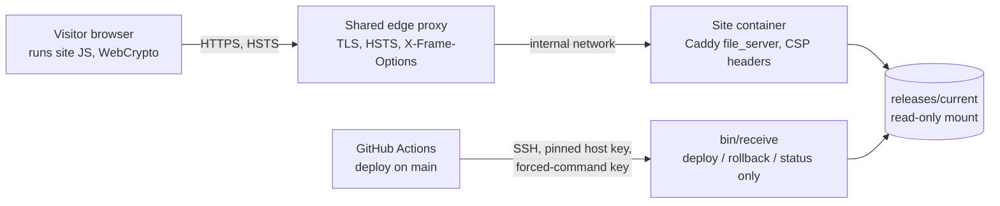

# Assurance case: the Shaffof home page

This document explains why the Shaffof home page (https://shaffof.wonmor.io) can be trusted to do what it says, and no
more. It covers the threat model, the secure design principles applied, the weaknesses countered, the results of a
security review of every script, the risks that remain, and which automated tests back each claim.

## 1. Scope

In scope:

- `site/`: the static home page in three languages (`/`, `/en/`, `/ru/`) and the 404 page. The pages are generated by
  `tools/render-pages.mjs` and served as files; there is no build step and no server-side code.
- The site scripts in `site/assets/js/`:
  - `theme.js`: runs before paint, applies the stored or system colour theme.
  - `merkle.js`: the Merkle tree used by the demo (hashing, tree building, inclusion proofs, verification).
  - `demo-core.js`: the demo's pure logic (strings, number formatting, amount parsing, tree layout, proof wording).
  - `main.js`: wires the demo and the page to the DOM.
  - `stage.js`: the animated hero picture on a `<canvas>`.
- Delivery: `deploy/Caddyfile` (headers, file server), `deploy/receive.sh` (server side of a deploy),
  `.github/workflows/ci.yml` and `.github/workflows/deploy.yml`.

Out of scope: the future ledger service, the zakat calculator (not released) and the shared edge proxy's own
configuration, which is managed outside this repository.

**What the site is.** A plan and a working in-browser demonstration of the verification idea, run on a fictional
sample ledger. It holds no money, takes no payments, has no accounts, no forms, no cookies and no analytics, and
sends nothing anywhere.

## 2. Threat model

### Assets

| Asset | Why it matters |
|---|---|
| Integrity of the published pages and scripts | Visitors must get exactly what is in `main` of this repository. |
| Truthfulness of the demo | The demo claims that any change to an entry changes the root and that a proof shows inclusion; that claim must hold. |
| Visitors' browsers | The page must not become a vehicle for script injection, tracking or clickjacking. |
| The deploy credential | The CI deploy key can publish a release to the web server. |

There are no user accounts, personal data, payment data or server-side secrets in the site to protect.

### Actors

- **Visitors**, including hostile ones who type arbitrary input into the demo or tamper with the page in their own
  browser (self-inflicted, no impact on others).
- **Network attackers** between the visitor and the site.
- **Third-party origins** that could inject content if the page loaded anything from them (it does not).
- **Contributors** who propose changes through pull requests.
- **An attacker who obtains CI or deploy access** (compromised workflow, dependency or secret).

### Trust boundaries

1. **Browser.** Everything the demo does happens in the visitor's browser. Input from the visitor crosses into the
   scripts only through the amount fields, the receipt selector, the reset/check buttons and the theme button. The
   page reads no URL parameters, fragments, `postMessage` data or cookies. `localStorage` holds only the theme name.
2. **Static server.** Caddy in a container serves `releases/current` from a read-only mount and adds the security
   headers. It executes nothing from the release.
3. **Edge proxy.** A shared reverse proxy terminates TLS and adds `Strict-Transport-Security` and
   `X-Frame-Options: DENY` on top of the site's headers.
4. **CI deploy.** `deploy.yml` runs only for pushes to `main` (or a manual run). It checks the site, stamps
   `site/version.txt` with the commit SHA and streams a tarball over SSH. The server key in `authorized_keys` is
   restricted with `restrict,command=...` to `bin/receive`, so it can only run `deploy <sha>`, `rollback` or `status`.
   The client pins the server host key (`StrictHostKeyChecking=yes` with a known-hosts secret, never trust on first
   use). `receive.sh` accepts only a 40-character hex SHA, caps the archive at 300 MB, extracts without owners or
   permissions, refuses links and special files, requires `site/version.txt` to equal the SHA, validates any new
   Caddyfile before switching, swaps releases with an atomic symlink rename and rolls back if Caddy fails to reload.

## 3. Secure design principles applied

| Principle (Saltzer and Schroeder, and successors) | How it is applied |
|---|---|
| Economy of mechanism | Static files, no build step, no framework, no runtime dependencies. About 800 lines of first-party JavaScript. |
| Fail-safe defaults | The CSP allows only same-origin resources, and no inline style except the favicon's `<style>`, pinned by its sha256 hash (`tools/check-site.mjs` fails on a `style` attribute, a `<style>` in a page, or an SVG `<style>` whose hash is not in the CSP). `verify()` rejects malformed proofs instead of checking part of them. Without WebCrypto the demo does not run and says so. |
| Complete mediation | Every amount typed is reduced to at most 12 ASCII digits before it reaches the tree; every stored theme value is checked against `light`/`dark`. |
| Open design | All code, the hashing rules (RFC 9162) and this document are public; security does not depend on secrecy. |
| Separation of privilege | The CI deploy key cannot open a shell; only a server administrator can change the container or `bin/receive`. |
| Least privilege | Workflows run with `permissions: contents: read`; checkout does not persist credentials; the server mounts releases read-only; `Permissions-Policy` turns off camera, microphone and geolocation. |
| Least common mechanism | No third-party origins, CDNs or embeds, so no shared state with other sites. |
| Psychological acceptability | The demo explains in plain words what it proves and labels the data as fictional. |
| Input validation with allowlists | Digits-only amounts, `light`/`dark` theme, proof sides `L`/`R`, 32-byte hashes, 64-hex-character roots. |
| Use vetted primitives | SHA-256 comes from the browser's WebCrypto (`crypto.subtle.digest`); no home-made cryptography. |

## 4. Common weaknesses countered

| Weakness | Countermeasure |
|---|---|
| CWE-79 Cross-site scripting (OWASP A03 Injection) | No HTML sinks in site JS: no `innerHTML`, `outerHTML`, `insertAdjacentHTML`, `document.write`, `eval` or `new Function`. All text is set with `textContent` or created as DOM nodes. The CSP (`script-src 'self'`, `object-src 'none'`, `base-uri 'self'`) blocks inline and foreign scripts even if markup were injected. `tools/check-site.mjs` fails CI on inline scripts and inline event handlers. |
| CWE-829 Inclusion of functionality from an untrusted control sphere | No third-party scripts, styles, fonts or images; fonts are self-hosted. `check-site.mjs` fails on third-party `src`, `srcset`, `link` and CSS `url()`; the end-to-end tests fail on any request that leaves the origin. |
| CWE-1021 Clickjacking | `frame-ancestors 'none'` in the CSP and `X-Frame-Options: DENY` at the edge. |
| CWE-319 Cleartext transmission | HTTPS only, `Strict-Transport-Security: max-age=31536000` at the edge. |
| CWE-200 / CWE-359 Exposure of information | No cookies, analytics or logs of visitor input; the demo sends nothing. `Referrer-Policy: strict-origin-when-cross-origin`. `check-site.mjs` fails on server addresses, internal hostnames, personal contact data, tokens and private keys in `site/`. |
| CWE-798 Hard-coded credentials | There are none in the site. The deploy key and host data live only in GitHub encrypted secrets and are removed from the runner after use. |
| CWE-327 / CWE-328 Broken or risky cryptography | SHA-256 from WebCrypto; RFC 9162 leaf (`0x00`) and node (`0x01`) prefixes; no duplicated last leaf. |
| CWE-345 Insufficient verification of data authenticity | Leaf encoding is canonical and covers every field shown, so a changed entry always changes its leaf hash (see finding F1). |
| CWE-20 Improper input validation | See the allowlists in section 3. |
| CWE-22 Path traversal (deploy) | `receive.sh` extracts into a fresh temporary directory and rejects links and special files; the SHA is checked against a strict pattern before it is used in a path. |
| Supply chain (OWASP A06/A08) | GitHub Actions pinned to full commit SHAs; one dev-only npm dependency (`@playwright/test`) pinned to an exact version with a lockfile and installed with `npm ci --ignore-scripts`; Dependabot proposes monthly grouped updates for both. |
| Security misconfiguration (OWASP A05) | Headers are in version control (`deploy/Caddyfile`), the end-to-end server reads them from that file, and the deploy smoke test fails if the live CSP is missing. |

## 5. Security review

Date: 2026-11-14. Method: manual line-by-line reading of every file in `site/assets/js/`, the page generator, the
Caddyfile, `receive.sh` and both workflows, looking for injection sinks, URL handling, storage use, cryptographic
misuse and Merkle tree weaknesses; then a test for every finding.

### Findings and fixes

| ID | Finding | Severity | Fix | Test |
|---|---|---|---|---|
| F1 | The leaf encoding was `id\|date\|cat\|amount`. It left out the direction (income or expense), so turning a donation into an expense of the same amount kept the same root, which contradicts the demo's claim that any change shows. The `\|` join was also not injective (`"A\|2026","x"` and `"A","2026\|x"` collide). | Medium (integrity claim of the demo) | Entries are now encoded as the JSON array `[id, date, cat, dir, amount]`: every shown field is bound and the encoding is injective. Non-string fields and amounts that are not non-negative safe integers are rejected. | `entry encoding` and `tampering is detected` in `tests/unit/merkle.test.mjs` |
| F2 | Building a tree of zero entries recursed without end (stack overflow). | Low (not reachable from the page) | The empty tree is SHA-256 of the empty string, as in RFC 9162. | `empty tree is SHA-256 of the empty string` |
| F3 | `path()` with an index outside the tree silently returned the path of another leaf. | Low | Out-of-range, negative and non-integer indices throw `RangeError`. | `path() rejects out-of-range and non-integer indices` |
| F4 | `verify()` treated any side value other than `L` as right, accepted sibling hashes of any length and compared the root case-sensitively. | Low | Proof steps must be `{hash: 32-byte Uint8Array, side: 'L' or 'R'}` and the root must be 64 hex characters (case-insensitive); anything else is rejected. | `malformed proofs and roots are rejected`, `an uppercase root is accepted` |
| F5 | `main.js` built the proof steps with `innerHTML`. Only constants and hash hex reached it, so it was not exploitable, but it was the only HTML sink in the site. | Informational (hardening) | The proof lines are built as `<b>` and text nodes with `textContent` (`demo-core.js: proofLines`); status areas are cleared with `textContent`. No HTML sinks remain. | `proofLines()` unit test; e2e `the amount field keeps digits only, so markup never reaches the page` |

### Checked and found sound

- **Second-preimage via missing domain separation:** not present. Leaves are hashed as `SHA-256(0x00 || data)` and
  nodes as `SHA-256(0x01 || left || right)`; the test suite shows that the classic forgery (an interior node
  presented as a leaf) works against plain SHA-256 and fails against this tree.
- **Duplicate-last-leaf ambiguity (CVE-2012-2459 style):** not present. Odd sizes split at the largest power of two
  below `n`, as in RFC 9162; `[a,b,c]` and `[a,b,c,c]` have different roots. Roots for sizes 1 to 8 match the
  published RFC 6962 reference vectors.
- **User input:** the amount fields keep at most 12 ASCII digits, so every value is a safe integer and nothing typed
  is ever inserted as markup. The receipt selector only offers fixed indices.
- **URL handling:** the scripts read no `location`, query string, fragment or referrer, and set no URLs. External
  links are plain links without `target="_blank"`.
- **Storage:** `theme.js` and `main.js` store and read only the theme name; values other than `light` or `dark`
  are ignored, and blocked storage is handled.
- **`stage.js`:** draws with the canvas API only (`fillText`, paths); the one attribute it reads (`data-root`, a
  label from the generated page) is drawn as text, never parsed.
- **Delivery:** no inline scripts or event handlers; the 404 page is served with status 404 and the same headers.

## 6. Residual risks

- **The demo is a sample, not a live ledger.** The "published" root is computed in the same page from the same
  fictional data, so the demo shows how the mechanism works, not that any real fund's report is genuine. A real
  deployment must publish the root through a channel the fund cannot rewrite (the plan uses OpenTimestamps).
- **No money is held** and no personal data is processed, so the impact of a site compromise is limited to
  defacement or a misleading demo.
- **The demo verifier uses left/right flags,** not the RFC 9162 leaf index and tree size. It answers "is this entry
  under this root", but it does not prove the entry's position or the tree size. A production verifier should use
  the index-based algorithm of RFC 9162 section 2.1.3.2 and bind the tree size to the published root.
- **HSTS** is set at the edge without `includeSubDomains` or preload; that is decided for the whole domain, outside
  this repository.
- **Whoever can push to `main` can publish.** The forced-command key limits what a stolen deploy key can do (publish
  or roll back a release, including its Caddyfile), but not what is published. This relies on repository rules for
  `main` and on the CI checks.
- **Insecure contexts:** without `crypto.subtle` (old browsers, plain HTTP) the demo does not run and says so.
- **The shared edge proxy and the host** are operated outside this repository and trusted for TLS and isolation.

## 7. How the tests back these claims

`npm test` runs both suites and then a combined coverage gate; CI (`.github/workflows/ci.yml`, required check `build`)
runs them on every pull request after `node tools/check-site.mjs`, a check that the generated pages match
`tools/render-pages.mjs`, ESLint with zero warnings allowed (`npm run lint`) and `reuse lint`.

**Unit tests** (`tests/unit/*.test.mjs`, Node's built-in `node:test`) load `merkle.js` and `demo-core.js`, the same
files the browser runs. Expected values come from an independent reference implementation written from the RFC 9162
text on top of `node:crypto`, and from the published RFC 6962 vectors (roots for sizes 1 to 8 and an audit path). A
coverage gate fails the run below 90% of lines, 80% of branches or 90% of functions of those two files; at the time
of writing coverage is 100% of lines, 98.33% of branches and 100% of functions.

**Combined coverage of every script under `site/`** (`tools/coverage.mjs`): the unit tests run again with Node's V8
coverage, the end-to-end tests record Chromium's V8 coverage of each page (`tests/e2e/fixtures.mjs`), and
monocart-coverage-reports merges both per file. A file no test loads counts as 0%. The gate fails below 90% of
statements, 90% of lines or 80% of branches in total; no code is excluded from measurement. At the time of writing:

| File | Statements | Branches | Lines |
|---|---|---|---|
| `demo-core.js` | 100% | 96.77% | 98.72% |
| `main.js` | 98.24% | 90.00% | 97.25% |
| `merkle.js` | 100% | 98.08% | 99.10% |
| `stage.js` | 97.88% | 90.96% | 95.36% |
| `theme.js` | 88.89% | 87.50% | 71.43% |
| **Total** | **98.29%** | **92.14%** | **96.62%** |

What stays uncovered is defensive early returns and environment fallbacks the tested Chromium never takes
(a missing element or string table, no `IntersectionObserver`, blocked `localStorage`, a canvas without a 2D
context, a coarse pointer) and a few timing branches such as a tab that is hidden while the animation runs.

**End-to-end tests** (`tests/e2e/`, `@playwright/test` in Chromium) serve `site/` with `tests/serve.mjs`, which reads
its response headers from `deploy/Caddyfile`, so the pages run under the production CSP.

| Claim | Test |
|---|---|
| Pages load with no console errors, page errors or CSP violations, and request nothing from other origins | `page /, /en/, /ru/ › loads with no console errors, ...` |
| Changing an amount changes the root; restoring it restores the root | `demo: changing an amount changes the root, ...` (all three languages) |
| A real entry is proven included; a fake one is not | `demo: the inclusion check says included for a real entry and not included for a fake` |
| Typed markup never reaches the page; amounts are capped at 12 digits | `demo: the amount field keeps digits only, ...` |
| Stored theme values are allowlisted | `stored theme values other than light/dark are ignored` |
| The hero renders, animates, and honours reduced motion | `hero canvas renders and animates`, `reduced motion › hero canvas shows one finished still frame` |
| Unknown paths get the 404 page with status 404 and the CSP | `unknown paths get the 404 page with links home` |
| Without WebCrypto the demo says it cannot run, and the rest of the page still works | `without WebCrypto the demo explains why it cannot run, ...` |
| Every animation phase draws without errors; the hero follows pointer, size and theme | `hero canvas: every phase of the animation draws, ...`, `hero canvas follows the pointer and the viewport size`, `reduced motion, theme switch › ...` |
| The two-reports illustration shows the silent edit, in turn or at once under reduced motion | `two reports: the silent edit plays in turn ...`, `reduced motion, theme switch › ...` |
| Domain separation, no duplicated leaf, tamper detection, strict proof checks | `tests/unit/merkle.test.mjs` |
