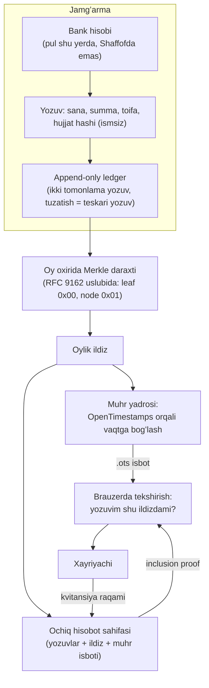
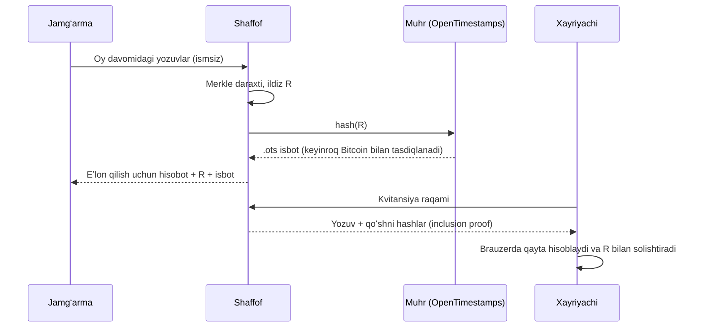

# Shaffof: reja

> **Sana:** 2026-11-13 · **Holat:** rejalashtirilmoqda, hali hech narsa chiqarilmagan
> **Sayt:** https://shaffof.wonmor.io · **Repo:** https://github.com/wonmortech/shaffof · **Litsenziya:** Apache-2.0
> Bu yuridik yoki diniy maslahat emas. Zakot boʻyicha har qanday hukm malakali olimlar tomonidan tasdiqlanishi shart.

## 1. Bir gapda

*Zakotingizni manbali usullar bilan hisoblang; xayriyangiz qayerga ketganini jamgʻarma oʻzgartira olmaydigan hisobotda koʻring.*

Shaffof ikki qismdan iborat:
1. **Tekshiriladigan xayriya hisoboti.** Jamgʻarma yozuvlari oylik Merkle ildiziga yigʻiladi, ildiz OpenTimestamps bilan vaqtga bogʻlanadi va eʼlon qilinadi. Istalgan odam hisobot keyin oʻzgartirilmaganini, xayriyachi esa oʻz kvitansiyasi hisobotda borligini tekshira oladi.
2. **Zakot kalkulyatori.** Mazhablar usullari yonma-yon, har birining manbasi bilan. Hukm chiqarmaydi. Olimlar yozma koʻrib chiqmaguncha chiqarilmaydi.

## 2. Maqsadlar

- Jamgʻarma hisobotini **isbot bilan** tekshirsa boʻladigan qilish: "bizga ishoning" oʻrniga "oʻzingiz tekshiring".
- Xayriyachiga **oʻz yozuvini** topish va tekshirish imkoni, ismini oshkor qilmasdan.
- Kichik jamgʻarma, masjid va mahalla qoʻmitasi ham foydalana oladigan **oddiy** vosita (bepul tarif).
- Zakot usullarini **manbasi bilan** koʻrsatadigan, maʼlumotni saqlamaydigan kalkulyator.
- Muhr va Sanad bilan **umumiy yadro**: kalitlar, Merkle jurnal, anchoring.

## 3. Maqsad emas (non-goals)

- ❌ **Pul bilan ishlash:** yigʻish, saqlash, oʻtkazish, toʻlov qabul qilish. Pul har doim jamgʻarmaning bank hisobi orqali yuradi.
- ❌ **Kripto:** token, kripto toʻlov, kripto-aktiv sotib olish yoki sotish. Muhrlash faqat hashni vaqtga bogʻlaydi.
- ❌ **Fatvo berish.** Kalkulyator usullarni koʻrsatadi, tanlov foydalanuvchi va uning olimida.
- ❌ **Xayriyachilar reytingi**, leaderboard, "eng saxiy" jadvali, ball.
- ❌ **Mablagʻ yigʻish platformasi** (fundraising) boʻlish.
- ❌ Ochiq hisobotda xayriyachi ismi yoki shaxsiy maʼlumoti.

## 4. Arxitektura

**Stek (dastlabki tanlov, oʻzgarishi mumkin):**
- Kalkulyator: statik, oflayn ishlaydigan veb (PWA), maʼlumot saqlanmaydi.
- Ledger: .NET + PostgreSQL; UPDATE/DELETE huquqlari olib qoʻyiladi, tuzatish faqat teskari yozuv bilan.
- Merkle: RFC 9162 xeshlash qoidasi; keyinroq summalarni ham tekshirish uchun Merkle sum tree.
- Anchoring: Muhr yadrosi orqali ochiq OpenTimestamps kalendarlari (bizda BTC boʻlmaydi).
- Telegram bot: `/zakot`, kvitansiya tekshirish.

**Bosh sahifadagi demo** ([site/assets/js/merkle.js](../site/assets/js/merkle.js)) shu gʻoyaning kichik nusxasi: 8 ta toʻqima yozuv, WebCrypto SHA-256, RFC 9162 boʻlinishi va inclusion path. U mahsulot emas.

## 5. MVP bosqichlari (8 hafta)

| Hafta | Natija |
|---|---|
| 1 | Usullar hujjati (manbalar bilan) olimlarga koʻrik uchun yuboriladi; 5 ta jamgʻarma yoki tashabbus bilan suhbat |
| 2 | Kalkulyator yadrosi (testlar bilan), nisob uchun narx manbasi (sana bilan) |
| 3 | Kalkulyator UI (uz/ru/en), oflayn, maʼlumot saqlanmaydi. **Ommaga chiqmaydi** |
| 4 | Ledger sxemasi va invariant testlari |
| 5 | Merkle sum tree, oylik ildiz, Muhr bilan muhrlash |
| 6 | Ochiq hisobot sahifasi va xayriyachi uchun inclusion proof |
| 7 | Telegram bot; demo jamgʻarma (test maʼlumoti, "demo" belgisi bilan) |
| 8 | Olim koʻrigi natijasini kiritish; research post; v0.1 faqat koʻrik ijobiy boʻlsa, aks holda faqat tadqiqot sifatida |

**Navbat:** Muhr (1–8 hafta) → Sanad (9–16 hafta) → Shaffof (olim koʻrigi kelgach). Shaffof umumiy yadroni qayta ishlatadi.

## 6. Olimlar koʻrigi darvozasi (majburiy)

Kalkulyatorning **har qanday ommaviy relizidan oldin**:
1. Usullar hujjati tayyorlanadi: har mazhab boʻyicha nisob, aktiv turlari (naqd, oltin/kumush, savdo moli, qarzlar, kripto-aktiv qiymati) va har qadamning manbasi.
2. Hujjat kamida bitta malakali olimga (yoki diniy idoraga) **yozma koʻrik** uchun yuboriladi.
3. Koʻrik javobi repoga (ruxsat bilan) qoʻshiladi; tuzatishlar kiritiladi.
4. Javob ijobiy boʻlmasa, kalkulyator chiqarilmaydi; ish faqat tadqiqot sifatida qoladi.
5. Saytdagi kalkulyator bloki shu vaqtgacha "Tez kunda — olimlar tekshiruvidan keyin" maketi boʻlib turadi.

## 7. v1 va keyingi bosqichlar

- **v0.1:** bitta pilot jamgʻarma, oylik ildiz, ochiq hisobot, kvitansiya isboti.
- **v1:** bir nechta jamgʻarma, hisobot sahifasini oʻz domenida joylash, Merkle sum tree (summalar yigʻindisini ham tekshirish), CSV/bank koʻchirmasidan import.
- **Keyinroq:** islomiy mikromoliya tashkilotlari uchun pullik audit-iz moduli (B2B dasturiy taʼminot); summani oshkor qilmasdan isbot (ZK) tadqiqoti; mustaqil auditor uchun tekshiruv vositasi.
- **Monetizatsiya:** kalkulyator va kichik jamgʻarmalar uchun bepul; komissiya yoki pul oqimidan ulush **hech qachon**.

## 8. Muvaffaqiyat oʻlchovlari

- Olimning yozma koʻrigi olingan.
- Kamida 1 ta haqiqiy jamgʻarma pilotga rozi.
- 1 000 ta kalkulyator sessiyasi (cookieʼsiz, shaxsiy maʼlumotsiz hisoblanadi), faqat reliz boʻlgandan keyin.
- Hisobotdagi har bir yozuv muhr bilan tekshiriladi; mustaqil odam isbotni bizning serverimizsiz qayta hisoblay oladi.
- 5 ta suhbatdan keyin muammo tasdiqlandi yoki rad etildi (ikkalasi ham natija).

## 9. Xavflar va choralar

| Xavf | Chora |
|---|---|
| **Riyo:** ochiq hisobot xayriyani koʻz-koʻz qilishga aylanishi | Ism yoʻq, reyting yoʻq, summalar faqat toifa boʻyicha; xayriyachi oʻz yozuvini faqat kvitansiya raqami bilan topadi. Savol olimlarga beriladi (11-12-savollar) |
| **Xayriyachi maxfiyligi:** kichik jamgʻarmada summa va sana orqali odamni taxmin qilish mumkin | Ochiq hisobotda ism va kontakt yoʻq; kvitansiya raqami tasodifiy; kichik summalarni yigʻib koʻrsatish varianti; shaxsga doir maʼlumotlar qonuni boʻyicha yurist maslahati |
| **Diniy notoʻgʻrilik** | Olim koʻrigi darvozasi, har qadam manbasi, "hukm emas" bloki |
| **Huquqiy:** mablagʻ yigʻish yoki toʻlov faoliyati deb qaralishi | Pulga umuman tegmaslik; yurist savoli (6-savol); saytda va shartlarda aniq yozish |
| **Soxta ishonch:** muhr hisobot *toʻgʻri* ekanini emas, *oʻzgarmagan*ini isbotlaydi | Saytda ochiq yozish: "isbot yozuv eʼlon qilinganidan beri oʻzgarmaganini koʻrsatadi, yozuvning haqiqatini emas"; bank koʻchirmasi bilan solishtirish yoʻli |
| **Jamgʻarmalar qiziqmasligi** | Kalkulyator ularsiz ham foydali; suhbatlardan oldin kod yozmaslik |
| **Kalit yoki server buzilishi** | Ildizlar mustaqil muhrlanadi; tekshirish mijoz tomonida; append-only jurnal |

## 10. Ochiq savollar

**Yurist uchun:**
- Pulni ushlamasdan xayriya hisobini yurituvchi va ochiq hisobot chiqaradigan dastur qanday talablarga tushadi? (tadqiqot hisobotidagi 6-savol)
- Ochiq hisobotdagi anonim yozuvlar (sana, summa, toifa) shaxsga doir maʼlumot hisoblanadimi?
- Hashni ochiq OpenTimestamps kalendarlari orqali muhrlash kripto-aktiv aylanmasi hisoblanmasligi (Muhr bilan umumiy savol).

**Olim uchun:**
- Kalkulyatordagi usullar va manbalar toʻgʻrimi, ayniqsa kripto-aktivlar, savdo moli va qarzlar boʻyicha? Qaysi mazhab variantlarini koʻrsatish kerak? (11-savol)
- Xayriyaning ochiq hisobotda koʻrinishi, anonim boʻlsa ham, riyo xavfini tugʻdiradimi? Qanday cheklov kerak? (12-savol)

**Bozor:**
- Oʻzbekistonda xayriya hisobotiga ishonch muammosi haqiqatan bormi? Jamgʻarmalar hozir hisobotni qanday eʼlon qiladi? (5 ta suhbat)

Batafsil manbalar: [research/](research/).
